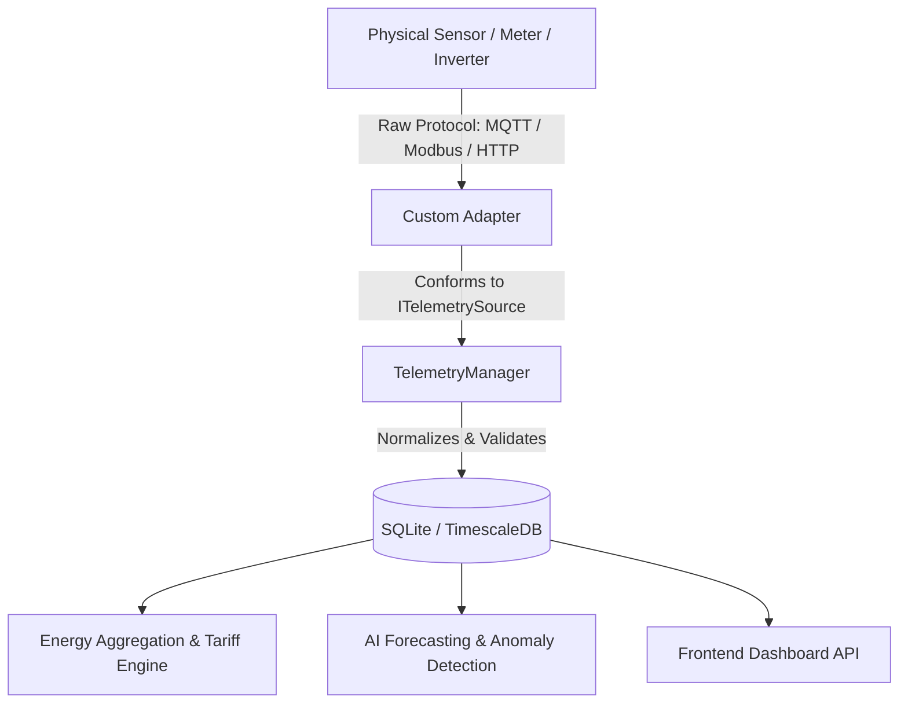

# Extension Guide: Adding New Hardware & Telemetry Adapters

Smart Energy Intelligence is built around an extensible, decoupled adapter architecture. You can easily integrate physical smart meters, MQTT brokers, Modbus/RS485 solar inverters, or Zigbee/Matter dongles without modifying frontend code or downstream business logic.

---

## 1. Architectural Overview

All external devices and data sources interface with the core platform via two abstract contracts defined in [adapter_interface.py](file:///c:/Users/USER/Downloads/project/smart-energy-intelligence/backend/app/services/telemetry/adapter_interface.py):

1. **`ITelemetrySource`**: Responsible for polling or receiving raw telemetry, validating payload structure, and producing standardized `CanonicalReading` records.
2. **`IDeviceController`**: Responsible for discovering controllable entities, testing permissions, and safely executing actuation commands (e.g., turn on/off).



---

## 2. Implementing a Custom Telemetry Source

To implement a new telemetry adapter (e.g., for an MQTT power meter or a SolarEdge inverter):

### Step 1: Create the Adapter Class

Create a new file in `backend/app/services/telemetry/` (e.g., `mqtt_adapter.py`):

```python
from datetime import datetime, timezone
from typing import List, Optional, Dict, Any
from app.services.telemetry.adapter_interface import ITelemetrySource, IDeviceController
from app.schemas.telemetry import (
    CanonicalReading,
    MeasurementType,
    MeasurementUnit,
    DataQuality
)

class MQTTTelemetryAdapter(ITelemetrySource, IDeviceController):
    """
    Example telemetry adapter ingesting JSON payloads from an MQTT topic
    and translating them into standardized CanonicalReading instances.
    """
    def __init__(self, broker_url: str, household_id: str = "household-01"):
        self.broker_url = broker_url
        self.household_id = household_id
        self._is_connected = False
        self._last_sync: Optional[datetime] = None

    @property
    def source_name(self) -> str:
        return "mqtt_shelly_broker"

    async def test_connection(self) -> Dict[str, Any]:
        # Connect and ping your MQTT broker or API endpoint
        connected = True  # Replace with actual ping check
        self._is_connected = connected
        return {
            "status": "connected" if connected else "unreachable",
            "broker": self.broker_url,
            "latency_ms": 12.4
        }

    async def get_latest_readings(self) -> List[CanonicalReading]:
        """
        Poll latest cached messages and map to CanonicalReading.
        SI Normalization is automatically handled by CanonicalReading.to_standard_units().
        """
        raw_samples = [
            {
                "topic": "shellies/shellyem-35/emeter/0/power",
                "val": 1250.0,      # Watts
                "unit": "W",
                "entity": "kitchen_main_feed"
            },
            {
                "topic": "shellies/shellyem-35/emeter/0/voltage",
                "val": 230.5,       # Volts
                "unit": "V",
                "entity": "grid_voltage"
            }
        ]

        readings: List[CanonicalReading] = []
        for s in raw_samples:
            m_type = MeasurementType.POWER if s["unit"] == "W" else MeasurementType.VOLTAGE
            m_unit = MeasurementUnit.WATT if s["unit"] == "W" else MeasurementUnit.VOLT

            reading = CanonicalReading(
                timestamp=datetime.now(timezone.utc),
                household_id=self.household_id,
                device_id="shelly_em_01",
                entity_id=s["entity"],
                measurement_type=m_type,
                value=s["val"],
                unit=m_unit,
                source_adapter=self.source_name,
                quality=DataQuality.GOOD,
                provenance="mqtt_qos1"
            )
            # Guarantee SI standard units (e.g. kW -> W, Wh -> kWh)
            readings.append(reading.to_standard_units())

        self._last_sync = datetime.now(timezone.utc)
        return readings

    async def discover_devices(self) -> List[Dict[str, Any]]:
        return [
            {
                "id": "shelly_em_01",
                "name": "Shelly EM Main Panel",
                "capabilities": ["power_monitoring", "voltage_monitoring"],
                "status": "online"
            }
        ]

    async def execute_action(self, device_id: str, action: str, params: Optional[Dict[str, Any]] = None) -> Dict[str, Any]:
        # Implement actuation if the adapter supports control
        return {
            "device_id": device_id,
            "action": action,
            "status": "executed",
            "confirmed_state": "on" if action == "turn_on" else "off",
            "simulated": False
        }

    async def get_health_status(self) -> Dict[str, Any]:
        return {
            "source": self.source_name,
            "connected": self._is_connected,
            "last_successful_sync": self._last_sync.isoformat() if self._last_sync else None
        }
```

---

## 3. Registering the Adapter in TelemetryManager

In [manager.py](file:///c:/Users/USER/Downloads/project/smart-energy-intelligence/backend/app/services/telemetry/manager.py), register your new adapter in `get_active_source()`:

```python
# app/services/telemetry/manager.py
from app.services.telemetry.mqtt_adapter import MQTTTelemetryAdapter

class TelemetryManager:
    ...
    def get_active_source(self) -> ITelemetrySource:
        adapter_type = os.getenv("TELEMETRY_ADAPTER", "demo").lower()
        if adapter_type == "mqtt":
            return MQTTTelemetryAdapter(broker_url=os.getenv("MQTT_BROKER_URL", "localhost:1883"))
        elif adapter_type == "home_assistant":
            return HomeAssistantAdapter()
        return DemoTelemetryAdapter()
```

Set `TELEMETRY_ADAPTER=mqtt` in your `.env` configuration.

---

## 4. Hardware Safety Guidelines

When adding smart plugs or circuit breakers:
1. **Critical Appliance Safety Policy**: Ensure the `DeviceSafetyService` in [safety.py](file:///c:/Users/USER/Downloads/project/smart-energy-intelligence/backend/app/services/automations/safety.py) evaluates the target entity. Devices flagged as `critical` or containing medical/refrigeration keywords will automatically be prevented from turning off.
2. **Action Confirmation**: Never assume an action was physically completed until the hardware adapter confirms receipt and state transition.
3. **Fail-Safe Ingestion**: Ingestion failure must report connection health status to the UI rather than silently falling back to synthetic demo data.
